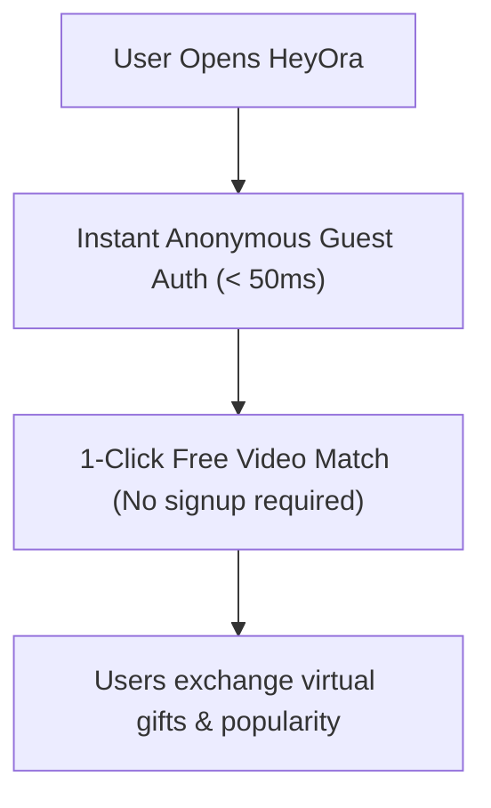

# HeyOra - System Architecture & Backend Guide

HeyOra is a 1-click random stranger video calling application with in-app gifting and zero-friction guest matchmaking.

> [!NOTE]
> **Cashout Status**: Creator cashout / real-money withdrawals are **STRICTLY LOCKED & DISABLED (`kEnableCashout = false`)**.
> Will remain disabled until specifically instructed by project owner. Diamonds represent in-app popularity score. This keeps all revenue in the owner's pocket, eliminates payout liabilities, and streamlines Google Play approval.

---

## 1. Do You Need a Database? (YES — Here is Why)

Even without cashouts, a cloud database is essential for:
1. **Coin & Diamond Balance Integrity**: Prevents users from tampering with local device storage to get infinite coins.
2. **Real-time Matchmaking Queue**: Pairs User A and User B within 300ms when they tap "Start Match".
3. **Hardware Device Bans & Reports**: Banned device IDs must be stored centrally so bad actors cannot re-enter simply by reinstalling.

### Recommended Database: **Supabase** (PostgreSQL)
* **Free Tier**: 500 MB database, 50,000 monthly active users, 5 GB bandwidth (**100% Free**).
* **Built-in Realtime**: Instant WebSocket matching without building a custom socket server from scratch.

---

## 2. Authentication Strategy: Instant Anonymous Guest

To give users the **Omegle zero-friction experience**:



* When the user opens the app, call `supabase.auth.signInAnonymously()`.
* The user receives a unique UUID in **under 50 milliseconds**.
* **No email, no password, no phone number required**. Immediate video discovery.

---

## 3. Database Schema (PostgreSQL / Supabase)

### Table: `users`
| Column | Type | Description |
| :--- | :--- | :--- |
| `id` | UUID (PK) | Unique user ID (from Supabase Auth) |
| `is_guest` | BOOLEAN | `true` (Anonymous guest default) |
| `coins` | INTEGER | Caller coin balance (Default: 100) |
| `diamonds` | INTEGER | Popularity points earned (Default: 0) |
| `device_id` | TEXT | Android hardware hash (for bans) |
| `is_banned` | BOOLEAN | Permanent ban status |
| `created_at` | TIMESTAMPTZ | Account creation timestamp |

### Table: `match_queue`
| Column | Type | Description |
| :--- | :--- | :--- |
| `id` | UUID (PK) | Queue entry ID |
| `user_id` | UUID (FK) | Reference to `users.id` |
| `filter` | TEXT | `'random'` or `'female'` |
| `channel_id` | TEXT | Assigned WebRTC / Agora channel |
| `status` | TEXT | `'waiting'`, `'matched'`, `'abandoned'` |
| `updated_at` | TIMESTAMPTZ | Heartbeat timestamp (cleaned every 10s) |

### Table: `reports`
| Column | Type | Description |
| :--- | :--- | :--- |
| `id` | UUID (PK) | Report ID |
| `reporter_id` | UUID | User who filed the report |
| `reported_id` | UUID | Offender user ID |
| `reason` | TEXT | Nudity, Harassment, Underage, Spam |
| `created_at` | TIMESTAMPTZ | Timestamp of report |

```sql
-- CASHOUT / WITHDRAWALS TABLE (PARKED / DISABLED FOR NOW)
/*
CREATE TABLE withdrawals (
  id UUID PRIMARY KEY DEFAULT gen_random_uuid(),
  user_id UUID REFERENCES users(id),
  diamonds INT NOT NULL,
  amount_inr NUMERIC NOT NULL,
  payout_method TEXT NOT NULL,
  payout_details TEXT NOT NULL,
  status TEXT DEFAULT 'pending',
  created_at TIMESTAMPTZ DEFAULT now()
);
*/
```

---

## 4. WebRTC Video Calling Architecture

To keep operating costs under **$50/month**:

```
[ User Phone A ] <--- P2P WebRTC Direct Video Stream (Cost: $0) ---> [ User Phone B ]
       |                                                                    |
       +-------> [ Coturn Server (TURN Relay for strict NAT: 20%) ] <------+
                                    |
                    [ Lightweight Signaling Server ]
                         (Node.js / Supabase RT)
```

1. **Signaling**: When two users match in the queue, the server exchanges SDP offers and ICE candidates.
2. **Media Stream**:
   - **80% of calls**: Direct Peer-to-Peer (STUN) $\rightarrow$ **$0 bandwidth cost**.
   - **20% of calls**: Routed through a cheap Coturn server (Hetzner VPS for ~$10/mo) for users behind carrier symmetric NATs.
