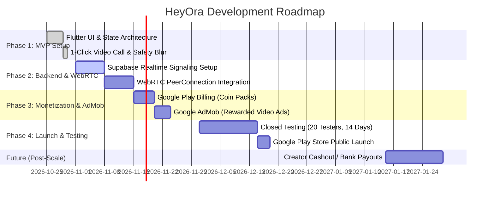

# HeyOra - Feature Catalog & Product Roadmap

HeyOra is a 1-click random video chat app that combines the instant fun of Omegle with fan appreciation gifts and strict UGC safety filters.

> [!NOTE]
> **Cashout Status**: Creator cashout / real-money withdrawals are **STRICTLY LOCKED & DISABLED (`kEnableCashout = false`)**.
> It will remain disabled until specifically instructed by the project owner. This ensures 100% of user coin purchases remain as pure platform profit with zero banking/tax overhead.

---

## 1. Feature Specifications

### 🎯 1. Instant 1-Click Matchmaking
* **Pulsing Radar Button**: Vibrant GPU-accelerated animated button on the home screen.
* **Zero Friction**: No username, password, or profile photo required to start matching.
* **Match Modes**:
  * **Random (Free)**: Matches with anyone online globally.
  * **Girls Only (🪙 10 Coins)**: Prioritizes female profiles.

### 🛡️ 2. The 3-Second "Blur Handshake" (OmeTV Protocol)
* When two users connect, the stranger's camera starts with a **heavy blur effect** and a 3-second countdown (`"Revealing in 3, 2, 1..."`).
* Allows the user to inspect movement in blur and hit **"Skip"** before viewing any inappropriate content.
* Dissuades flashers and trolls from abusive behavior.

### 📹 3. Live Video Call Experience
* **Picture-in-Picture (PiP)**: Draggable / floating local selfie preview.
* **Camera Flip & Mic Mute**: Instant toggling between front/back camera and microphone.
* **Live Session Timer**: Shows active call duration in `MM:SS`.
* **Central Skip Button**: Instant one-tap disconnect and match with the next stranger in under 500ms.

### 🎁 4. Virtual Gifting & Celebrations
* **Gift Tray**: Bottom sheet with 6 animated gifts:
  * 🌹 **Rose** (10 Coins $\rightarrow$ 7 💎 Popularity)
  * 💖 **Love Heart** (25 Coins $\rightarrow$ 18 💎 Popularity)
  * 🎂 **Party Cake** (50 Coins $\rightarrow$ 35 💎 Popularity)
  * 💍 **Diamond Ring** (150 Coins $\rightarrow$ 105 💎 Popularity)
  * 🏎️ **Supercar** (500 Coins $\rightarrow$ 350 💎 Popularity)
  * 🏰 **Royal Castle** (1,000 Coins $\rightarrow$ 700 💎 Popularity)
* **Floating Banner**: Sends real-time animated notification across the video viewport when a gift is given.

### 💎 5. Diamond Popularity Score (Cashout Paused)
* Displays accumulated Diamonds representing in-app fan appreciation and status.
* *Note: Real-money cashout feature is parked and disabled until future phases.*

### 📺 6. Rewarded Video Ad "Free Fuel" Loophole
* Non-paying users can tap **"Watch Ad for +15 Free Coins"**.
* Unlocks gender filters and gift sending without spending real money.
* Generates high eCPM ($5 – $20) from free users.

### 🚨 7. Google Play Safety & Compliance
* **18+ Consent Dialog**: Fullscreen terms acceptance modal on first launch.
* **1-Tap Report & Block**: Instantly disconnects call and ensures users never match again.
* **Categorized Reporting**: Nudity, Harassment, Underage (<18), Spam.

### 🏆 8. Competitive Daily & Weekly Leaderboard
* **Dynamic Timeframe Toggles**:
  * **Daily ⚡**: Resets every 24h at 00:00 UTC with live ticking countdown timer (drives high DAU & daily urgency).
  * **Weekly 🏆**: Resets every Sunday at 00:00 UTC (prestige battle for crowns).
  * **All-Time 👑**: Permanent Hall of Fame honoring VIP spenders and top creators.
* **Dual Categories**:
  * **Top Stars 💎**: Ranked by Diamonds earned from stranger appreciation gifts.
  * **Top Gifters 🎁**: Ranked by Coins spent (rewards whales with VIP badge recognition).
* **Olympic 3-Step Podium**: Glowing gold 🥇, silver 🥈, and bronze 🥉 crowns with avatar glow rings.
* **Your Standing Sticky Bar**: Real-time position tracking with instant 1-tap call to action (*"Go Live"* or *"Get Coins"*).

---

## 2. Product Roadmap

