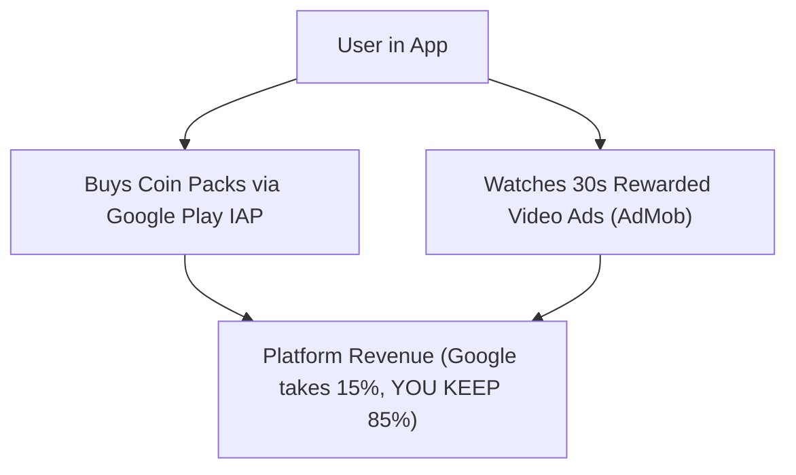

# HeyOra - Monetization & Compliance Guide

A focused monetization, safety, and Google Play compliance guide for HeyOra.

> [!IMPORTANT]
> **Cashout Status**: Real-money cashout to creators is **disabled**.
> **Why this is a huge advantage for launch:**
> 1. **Zero Banking Friction**: You do not need to register a company, open a current account, or set up Cashfree/RazorpayX payout APIs right now.
> 2. **Zero Tax/TDS Overhead**: No complex Section 194R Indian tax filings.
> 3. **Fast Google Play Approval**: Google reviews standard social chat apps with virtual coin gifting **much faster** than apps that advertise earning real cash.

---

## 1. Active Monetization Model (Coin IAP + Rewarded Ads)

Without creator payouts, your revenue model is pure, simple profit:

### 1. In-App Purchase Coin Packs (Google Play Billing)
* Callers purchase Coin bundles to unlock **"Girls Only"** filter (10 Coins) or send fun gifts.
* Example Pricing:
  * 🪙 **100 Coins**: ₹79 ($0.99)
  * 🪙 **550 Coins**: ₹399 ($4.99)
  * 🪙 **1,200 Coins**: ₹799 ($9.99)
* **Google's Cut**: 15% (under Google's 15% tier for the first $1M/year).
* **Your Profit Margin**: **85% pure revenue**.

### 2. Rewarded Video Ads (Google AdMob)
* Free users can tap **"Watch Ad for +15 Free Coins"**.
* Rewarded ads pay high eCPMs ($5.00 – $20.00) because users voluntarily watch the full 30 seconds.

---

## 2. Indian Law & IT Act Compliance

1. **Section 67 and 67A of the IT Act**:
   * Transmitting sexually explicit content in electronic form is a criminal offense in India.
   * Enforced via **instant permanent device ID bans** for reported offenders.
2. **MeitY & UGC Compliance**:
   * Positioned strictly as **"Global Social Video Discovery"**.
   * Not advertised as adult dating or paid companion services.

---

## 3. Google Play Store Personal Account Checklist

- [x] **20 Testers for 14 Days**: Required for personal accounts created after Nov 2023 before public release.
- [x] **1-Tap Report & Block**: Must be accessible on the call screen at all times.
- [x] **18+ Community Terms Agreement**: Shown before entering the video queue.
- [x] **IARC Content Rating**: Set to **Mature 17+ / 18+** due to live UGC video.
- [x] **Google Play Billing**: All coin purchases inside the app **MUST** use Google Play IAP.
- [x] **No Cashout Scrutiny**: Because real-money cashout is disabled, the app is exempt from real-money gaming and financial service restrictions.

---

## 4. Creator Cashouts Policy (STRICTLY LOCKED)
> [!CAUTION]
> **Policy Directive**: Keep disabled until specifically instructed by the project owner to turn on (`kEnableCashout = false`).
> 
> **Why this keeps 100% of profit in your pocket:**
> * All coin purchases (₹79 to ₹1,499) stay directly with you (Google takes 15%, you keep 85%).
> * Callers buy coins to gift creators; creators earn **Diamond Popularity Score** and VIP status badges.
> * Since cashout is locked, your payout liability is **₹0.00**.
> * Code is preserved in [user_state.dart](file:///c:/CODE/FL/heyora/lib/models/user_state.dart) and [wallet_screen.dart](file:///c:/CODE/FL/heyora/lib/screens/wallet_screen.dart) for potential future phases, but will never be enabled without an explicit instruction from the owner.
